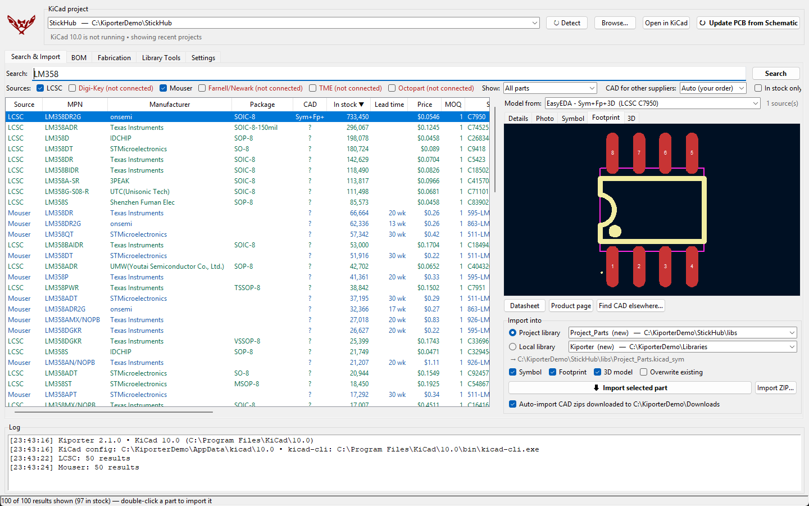
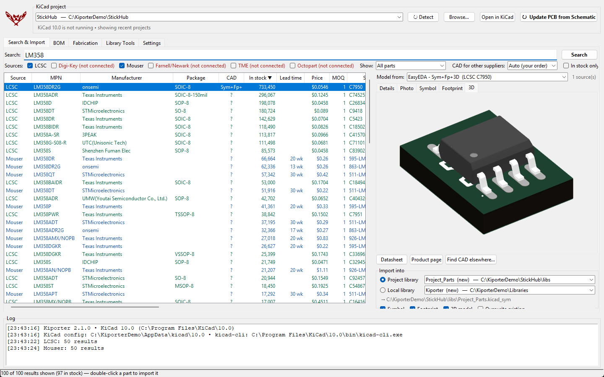
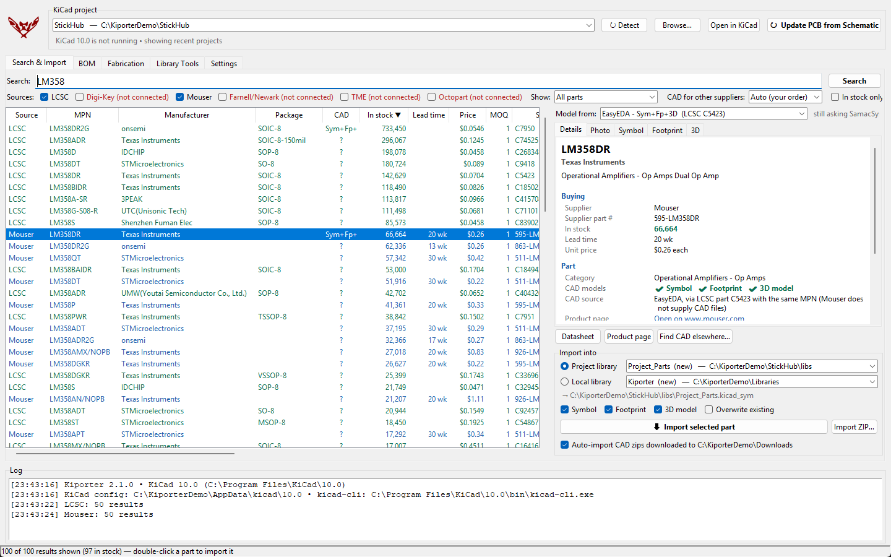
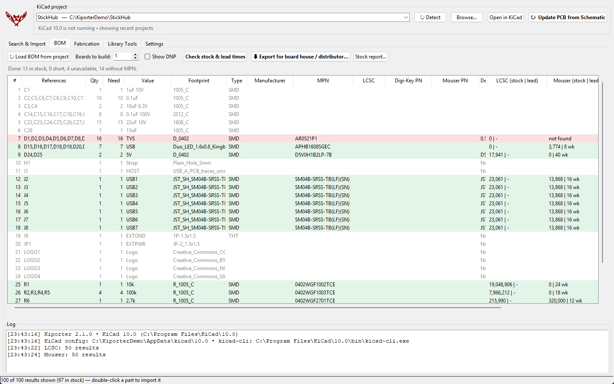
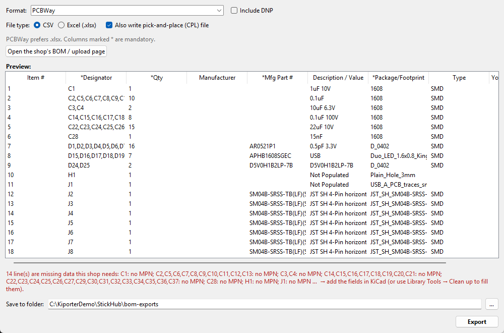
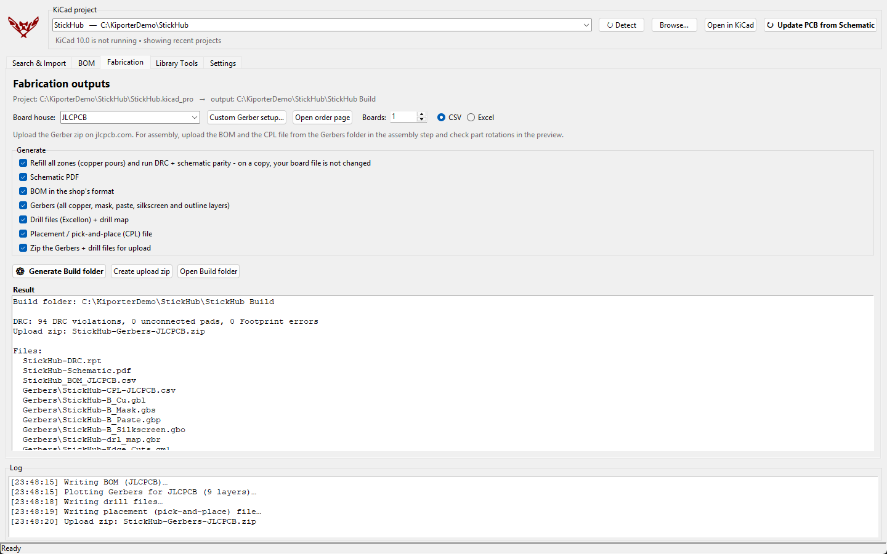
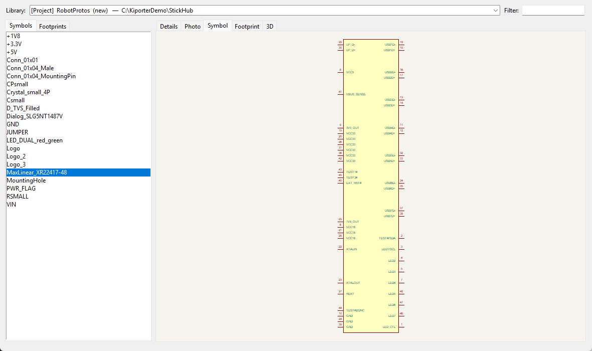
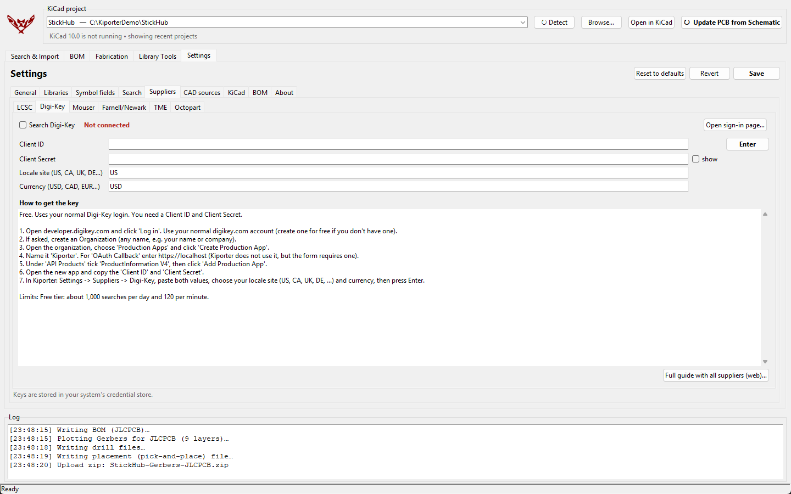

# Kiporter

**A stand-alone KiCad companion for Windows, macOS and Linux.** Search parts at six suppliers,
preview them, and import the symbol, footprint and 3D model into your project or your own
libraries. Kiporter also keeps your libraries tidy, checks BOM stock and lead times, and
produces ready-to-order fabrication files. It runs outside KiCad (no plugin to start from the
PCB editor) and finds your open project automatically.

Inspired by [Import-LIB-KiCad-Plugin](https://github.com/Steffen-W/Import-LIB-KiCad-Plugin).

If Kiporter saves you time, you can support it on [Ko-fi](https://ko-fi.com/speed7861).

## Screenshots

| | |
|---|---|
| **3D preview** rendered by KiCad  | **Part details** and where the CAD model comes from  |
| **BOM stock check** across suppliers  | **BOM export** for board houses and distributors  |
| **Fabrication files** in one click  | **Library browser** with symbol, footprint and 3D previews  |
| **Supplier setup** with step-by-step key directions  | |

The screenshots show StickHub, one of the example projects that ships with KiCad.

## Why I made Kiporter

I built Kiporter out of frustration. Getting a part into KiCad, with its symbol, footprint and
3D model all linked up, took far more work than it should:

- **Too much setup.** Most import tools made me configure path variables, edit library tables
  and fix 3D model paths by hand before anything worked. I'd lose time on configuration
  instead of designing.
- **Stuck in the board editor.** Most plugins only run from inside the PCB editor. When I'm
  picking parts, I'm usually in the schematic, or KiCad isn't open at all.
- **Scattered workflow.** Searching suppliers, downloading CAD files, unzipping them, importing
  each piece and wiring up the links were all separate jobs in separate places.

So I made a single program that runs on its own. It finds your KiCad install and open
project, sets up the libraries and paths for you, and handles the whole job: search, preview,
import, BOM and fabrication files. It's meant to work straight away, without the
configuration.

## Install

You need **KiCad 8 or newer** (KiCad 9+ is required for 3D previews) and an internet connection.

Download the latest version from the
[Releases page](https://github.com/speed7861/kiporter/releases/latest) (Source code ZIP) and unzip it.

| OS | How |
|---|---|
| **Windows** | Double-click **`Install.bat`** in the unzipped folder. It installs Python if needed, creates the Desktop and Start Menu shortcuts, and starts Kiporter. |
| **macOS** | In Terminal: `./install.sh`. This creates `~/Applications/Kiporter.app`. It needs Python 3.9+ with Tk; the script offers to install it with Homebrew. |
| **Linux** | In a terminal: `./install.sh`. This adds Kiporter to the app menu and a `kiporter` command. On Ubuntu/Debian it offers to install `python3-venv python3-tk`. Optionally install `xdotool wmctrl`. |

Kiporter works with standard KiCad installs:
- Windows: `Program Files` or per-user installs
- macOS: `/Applications/KiCad`
- Linux: distribution packages and the Flatpak

On first start, Kiporter creates and registers a default local library, enables KiCad's API,
and offers to connect suppliers.

## How to use Kiporter

### First start (about 2 minutes, once)

1. **Open Kiporter** from the shortcut the installer created.
2. **Connect suppliers (optional).** A welcome message offers to do this; you can also skip it.
   LCSC works with no account. For Digi-Key, Mouser and the others, open
   **Settings → Suppliers**, follow the directions on the supplier's tab, paste the key and
   press **Enter**. Suppliers that aren't connected yet are shown in red.
3. **Pick where new parts go.** Kiporter asks which library to import into:
   - **Project library:** the parts live inside your project folder, so the project carries them along.
   - **Local library:** shared by all your projects.

   Pick one, or let Kiporter create a new library. You can change it any time in the
   **Import into** box.

### Add a part to your design

1. **Open your project in KiCad.** Kiporter finds it automatically; it's shown at the top
   marked **● OPEN**. If it isn't, click **Detect** or **Browse…**.
2. **Search.** On the **Search & Import** tab, type a part number or keyword (for example
   `LM358` or `10k 0603`) and press **Enter**.
3. **Choose a result.** Results are sorted by stock, most first. The columns show stock,
   lead time, price and CAD availability. Use **Show** to list only parts with a symbol +
   footprint (+ 3D model).
4. **Check it** in the preview on the right: **Details**, **Photo**, **Symbol**,
   **Footprint** and **3D**. For parts from Mouser, Digi-Key and other suppliers, the
   **Model from** list lets you compare models from different CAD sources.
5. **Import it.** Double-click the part, or click **⬇ Import selected part**. The part's
   name is copied to your clipboard.
6. **Place it in KiCad.** In the Schematic Editor press **A** and paste (**Ctrl+V**) to
   find it. Then click **Update PCB from Schematic** in Kiporter to send it to the board.

> The first time a new library is used, restart KiCad (local library) or reopen the project
> (project library) once so KiCad loads it.

**No model available?** Click **Find CAD elsewhere…**, download the KiCad ZIP from SnapEDA,
Ultra Librarian or SamacSys, and save it to your Downloads folder. Kiporter imports it
automatically.

### Check stock and export the BOM

1. On the **BOM** tab, click **Load BOM from project**.
2. Set **Boards to build** and click **Check stock & lead times**. Each line turns green
   (in stock), orange (short) or red (unavailable).
3. Click **Export for board house / distributor…**, choose a format (for example JLCPCB, or
   your own KiCad BOM preset marked ★), check the preview and click **Export**.

### Get files to order boards

1. On the **Fabrication** tab, choose your **Board house**.
2. Click **Generate Build folder**. Kiporter refills zones and runs DRC on a copy of the
   board (your file isn't changed). It then writes the schematic PDF, BOM, Gerbers, drill
   files, pick-and-place file and an upload ZIP into `<Project> Build` next to your project.
3. Read the **Check before ordering** notes, such as DRC errors or missing part numbers,
   then upload the ZIP to the board house.

Need a different setup? Click **Custom Gerber setup…** to choose the layers and file options yourself.

### Keep your libraries tidy

Open the **Library Tools** tab:
- **Clean up & auto-link:** fixes missing links between symbols, footprints and 3D models.
- **Merge libraries:** combines several libraries into one.
- **Make project self-contained:** copies every part a project uses into its project
  library, before you share or archive it.
- **KiCad setup check:** finds broken library paths.
- **Browse & preview a library:** shows what's in any library.

Every fix is shown first and a backup is made before anything changes.

### Change how Kiporter works

Everything is under **Settings**:
- **Libraries:** default libraries.
- **Symbol fields:** the names of the fields added to imported symbols.
- **Search:** search and preview options.
- **Suppliers:** API keys.
- **CAD sources:** which CAD libraries are used for non-LCSC parts, and in what order.
- **KiCad:** which KiCad version to use.
- **BOM:** BOM defaults.

Click **Save** when you're done.

## Features

### Search & Import
- **One search, six suppliers:**
  - LCSC (no account needed)
  - Digi-Key
  - Mouser
  - Farnell / Newark / element14
  - TME
  - Octopart (via Nexar)
- **Same columns for every supplier:** stock quantity, lead time, price, MOQ, package and
  supplier part number. Results are **sorted by stock** (most available first), and an
  *in stock only* filter is available.
- **CAD column and filter:** shows whether a symbol, footprint and 3D model are available.
  You can show only parts with a **symbol + footprint**, or **symbol + footprint + 3D model**.
- **Previews:** part photo, the **symbol** and **footprint** drawn in the app, and a **3D render**
  produced by KiCad itself.
- **One-click import** of the model shown in the preview. If a model can only be downloaded
  in your browser, Kiporter opens the page and **auto-imports the ZIP you download**.
- **Choose where CAD models come from.** Suppliers' APIs (Digi-Key, Mouser, …) sell parts but
  don't hand out CAD files, so Kiporter gets models from CAD libraries:

  | Source | Account needed |
  |---|---|
  | **EasyEDA** (LCSC's library) | none |
  | **SamacSys / Component Search Engine** (the models Mouser links to) | none to search; a free account to download |
  | **Octopart** (lists SnapEDA, Ultra Librarian and other models) | your Octopart/Nexar keys |
  | **SnapEDA** | through Octopart, or opened in your browser |

  LCSC parts always use their own EasyEDA model. For every other supplier you choose:
  - which sources are used, and in what order (Settings → CAD sources);
  - a default under **CAD for other suppliers**;
  - per part, the **Model from** list above the preview, to compare and pick.

  Lookups are cached on disk and paced, so free services aren't overloaded.
- **Consistent symbol fields across all sources:** Manufacturer, MPN, Package, Datasheet,
  Description and each supplier's part number. Vendor spellings such as `MFGR` or
  `Manufacturer_Name` are folded into these names.
- **ANSI or IEC resistors:** suppliers mostly draw resistors as IEC boxes. Kiporter redraws plain
  resistors as ANSI zigzags on import (or as IEC boxes, or leaves them alone - your choice in
  Settings → Libraries).
- **Choose the destination library at start-up:** the project library, one of your existing
  local libraries, or a new one. Kiporter registers it in KiCad's library tables and links
  the 3D paths automatically.
- **Update PCB from Schematic** button (uses the KiCad API, or presses the F8 shortcut as a fallback).

### BOM
- **View the project BOM:** references, quantities, SMD/THT type, MPNs, supplier part numbers
  and DNP status.
- **Stock & lead-time check** at every connected supplier, for the number of boards you plan
  to build.
- **Export for board houses:** JLCPCB, PCBWay, ALLPCB, Seeed Fusion, NextPCB, Eurocircuits,
  Aisler, MacroFab, with pick-and-place/CPL files.
- **Export for distributor BOM tools:** Digi-Key, Mouser and LCSC.
- Exports as CSV or Excel.
- **Your own BOM formats are listed first (marked with ★):** your project's KiCad BOM settings, BOM presets saved in any of your recent projects, and BOM plugin scripts you registered in any KiCad version or added in Kiporter. KiCad's built-in presets and the BOM scripts that ship with KiCad are listed after them. Each has a live preview. If a plugin's script has moved, pick its new location once and Kiporter remembers it.

### Fabrication
One click creates a `<Project> Build` folder containing:
- the schematic PDF, the BOM and a DRC report;
- a `Gerbers` sub-folder with Gerbers, drill files and the placement file, set up for the
  board house you pick;
- an upload ZIP.

Zones are refilled and DRC is run on a copy first, so your board file is never changed.

If no preset fits, make a **custom Gerber setup**. You choose the layers, Gerber options (Protel extensions, X2, netlist attributes, soldermask subtraction, precision), drill options (format, units, zeros, origin, separate PTH/NPTH, drill map) and the BOM format. You can also use the plot settings saved in the board.

### Library Tools
- **Clean up & auto-link:** links symbols to footprints and footprints to 3D models, repairs
  broken or legacy `${KISYS3DMOD}` paths, normalizes fields and fills missing data.
- **Merge libraries** (including 3D models), and optionally re-point a project at the merged library.
- **Make project self-contained:** copies every part a project uses into its project library.
- **Browse & preview** any library.
- **KiCad setup check:** finds hidden stock libraries, broken library-table entries and a
  disabled API.
- **Back up a library** to a ZIP file.

## Supplier API keys

LCSC works immediately. Digi-Key, Mouser, Farnell/Newark, TME and Octopart each give out
**free API keys**: you sign in with your normal account and create a key. Step-by-step
directions are in **Settings → Suppliers** inside the app (paste the key and press **Enter**; suppliers without a key are shown in red as *not connected*), and in
**[docs/API_KEYS.md](docs/API_KEYS.md)**. Keys are stored in your system's credential store
(Windows Credential Manager, macOS Keychain or Linux Secret Service).

## Notes
- After a *new* library is registered, restart KiCad once (local library) or reopen the
  project (project library). Later imports show up without restarting.
- Board houses update their BOM/CPL templates from time to time. Check the preview in
  Kiporter's export dialog and the shop's own page before ordering.
- On macOS, the Update-PCB keyboard fallback needs Accessibility permission. On Linux/X11 it
  needs `xdotool`.

## Support
Kiporter is free. If you find it useful and want to say thanks, you can donate at
**[ko-fi.com/speed7861](https://ko-fi.com/speed7861)**.

## License
Kiporter is free software under the [GNU General Public License v3.0](LICENSE).
